  

  

 

## `// whoami`

Oi, eu sou o **Pedro**. Sou **desenvolvedor back-end** e estudante de **Análise e Desenvolvimento de Sistemas na FATEC Cruzeiro**.

Meu foco é **APIs, automações e Inteligência Artificial**: gosto de construir o que roda por trás — integrações, bancos de dados e processos que economizam trabalho manual.

<b>English</b>

 

Hi! I'm **Pedro**, a **back-end developer** studying **Systems Analysis and Development at FATEC Cruzeiro**.

I focus on **APIs, automation and Artificial Intelligence**: I enjoy building what runs behind the scenes — integrations, databases and processes that cut out manual work.

 

## `// stack`

<b>BACKEND</b>  

<b>INFRAESTRUTURA E DADOS</b>  

<b>FRONTEND</b>  

<b>FERRAMENTAS</b>  

 

 

## `// stats`

<!-- A instância pública do github-readme-stats vive estourando o limite e quebrando as imagens.
     Faça um fork de github.com/anuraghazra/github-readme-stats, deploy grátis na Vercel
     e troque o domínio abaixo pelo da sua instância. -->

&nbsp;

  

<code>pedro@chaves:~$ exit 0</code>

